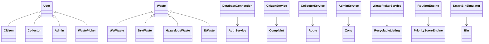
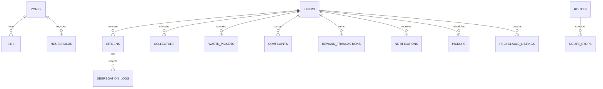

# Architecture Overview

## Layered architecture

The system follows a layered architecture across model, DAO, service, engine, pattern, and UI. The application initializes the database once, seeds baseline records, and routes work through service classes to provide logic and validation.

## Class diagram

## ER diagram

